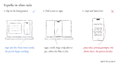

# Espelho

A skill for driving a real iPhone from a Mac through iPhone Mirroring, with computer-use tools. It says what works without taking the screen, what needs full-screen control, how to get files onto the phone, which screens are dead ends, and where to stop and hand over to the person.

*Espelho* is Portuguese for mirror.



> **Em português:** skill para mexer no iPhone pelo Espelhamento do iPhone no Mac. Diz o que funciona em segundo plano (toques e o menu Visualizar), o que precisa da tela inteira (digitar, rolar, arrastar), como levar arquivos pelo iCloud Drive, como usar um atalho assinado quando a janela não dá conta, e onde parar: senha, permissão de privacidade e folha de Compartilhar ficam com a pessoa.

## Install

Clone or copy this folder into your skills folder:

```bash
git clone https://github.com/LimaJoota/espelho
```

## What it needs

- macOS with iPhone Mirroring, and an iPhone that can mirror (locked, nearby, Wi-Fi and Bluetooth on).
- Best: [mirroir-mcp](https://github.com/jfarcand/mirroir-mcp), which taps, types and scrolls without taking the screen.
- Or computer-use tools that tap in an app window in the background (`app_*`) and take the full screen (`computer_batch`) to type and scroll.

## What it covers

- Setup and the "Timed Out" screen.
- Background mode: taps work, the View menu works, typing, scrolling and dragging do not.
- Full-screen mode: Spotlight with `cmd+3`, typing, and new coordinates after the window moves.
- Small screenshots, zoom on one region, batched actions.
- Mac to iPhone files over iCloud Drive.
- Signed shortcuts with `shortcuts sign` for jobs the window cannot do, such as the wallpaper.
- Hard lines: no passcodes, no privacy prompts, no taps on people in the Share sheet.

## With mirroir-mcp

[mirroir-mcp](https://github.com/jfarcand/mirroir-mcp) moves the phone. Espelho says where to go and where to stop. When the server is connected, the skill uses it first: `describe_screen` in place of screenshots, and typing and scrolling with the screen left to you. `references/mirroir.md` has the setup, a short permission file and which tools borrow the front for a second.

Without it, the skill falls back to plain computer-use tools. The field notes hold either way: which screens fail while mirroring, how to get files over, when a signed shortcut beats tapping, and where to stop.

## Status

Written from one hands-on session. Not yet run end to end as a skill. The lines marked "not tested yet" in `references/routes.md` are guesses to check.

## License

MIT
